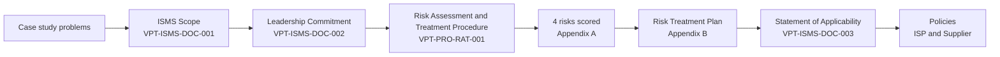

# VaultPay Technologies: ISO/IEC 27001:2022 ISMS Implementation


A complete, audit-style document set for a fictional fintech: scope, leadership commitment, risk assessment and treatment, a Statement of Applicability, and two core policies. Built as a GRC Analyst portfolio project for the 10Alytics GRC program.

> **Disclaimer:** VaultPay Technologies is a **fictional company** from a training case study. Every document here is an educational exercise. No real company, customer or confidential data is included, and nothing here is a certified or audited ISMS. The "Internal - Confidential" labels on the documents are part of the exercise, to mimic real document control.

---

## Contents

- [The case](#the-case)
- [What is in this repository](#what-is-in-this-repository)
- [How the documents fit together](#how-the-documents-fit-together)
- [From problem to control](#from-problem-to-control)
- [Risk assessment at a glance](#risk-assessment-at-a-glance)
- [Statement of Applicability at a glance](#statement-of-applicability-at-a-glance)
- [Key policy requirements](#key-policy-requirements)
- [Design decisions](#design-decisions)
- [Project workflow](#project-workflow)
- [Repository structure](#repository-structure)
- [Known gaps and roadmap](#known-gaps-and-roadmap)
- [Disclaimer](#disclaimer)
- [Skills demonstrated](#skills-demonstrated)
- [Standards referenced](#standards-referenced)
- [Author](#author)

---

## The case

VaultPay Technologies is a financial technology company headquartered in Austin, Texas, with about 260 employees. It runs digital payment processing and secure payment gateway services for online merchants and enterprise clients, so it handles cardholder data.

The company had no formal information security controls. The case study identified four connected problems:

1. No unified security framework governing how payment data is protected across systems.
2. Risk management practices that are inconsistent, with no formal methodology.
3. Weak access controls.
4. Incident response that is entirely reactive.

Together these weaken VaultPay's ability to protect cardholder data and to demonstrate compliance to enterprise customers. The engagement: act as the GRC Analyst and design an ISO/IEC 27001:2022 aligned ISMS to close those gaps.

---

## What is in this repository

Six Word documents, each version 1.0, issued October 27, 2026, in one consistent style (control page, numbered sections, standard header and footer).

| # | Document | ID | ISO 27001 link | Pages |
|---|----------|----|----------------|-------|
| 1 | [ISMS Scope Statement](docs/ISMS%20Scope%20Statement%20-%20VaultPay%20Technologies.docx) | `VPT-ISMS-DOC-001` | Clause 4.3 | 3 |
| 2 | [Leadership and Commitment Statement](docs/Leadership%20and%20Commitment%20Statement%20-%20VaultPay%20Technologies.docx) | `VPT-ISMS-DOC-002` | Clause 5.1 | 3 |
| 3 | [Statement of Applicability (SoA)](docs/Statement%20of%20Applicability%20%28SoA%29%20-%20VaultPay%20Technologies.docx) | `VPT-ISMS-DOC-003` | Clause 6.1.3 | 6 |
| 4 | [Risk Assessment and Treatment Procedure](docs/Risk%20Assessment%20and%20Treatment%20Procedure%20-%20VaultPay%20Technologies.docx) | `VPT-PRO-RAT-001` | Clauses 6.1.2, 6.1.3, 8.2, 8.3 | 9 |
| 5 | [Information Security Policy](docs/Information%20Security%20Policy%20-%20VaultPay%20Technologies.docx) | `VPT-POL-ISP-001` | Clause 5.2 | 7 |
| 6 | [Third-Party/Supplier Security Policy](docs/Third-Party%20Supplier%20Security%20Policy%20-%20VaultPay%20Technologies.docx) | `VPT-POL-SUP-001` | Annex A 5.19 to 5.23 | 7 |

Page counts are approximate and may vary slightly between Word and other viewers.

---

## How the documents fit together



The chain is traceable end to end: every control in the SoA is linked to at least one risk, every risk is scored with a documented method, and the policies state the rules that make those controls operate. The SoA and the Risk Treatment Plan are generated from the same control list, so they cannot disagree.

---

## From problem to control

| Case study problem | Risk ID | Inherent | Residual (target) | Annex A controls selected | Policy that addresses it |
|---|---|---|---|---|---|
| No unified framework for payment data | `VPT-RISK-001` | 20, Critical | 10, Medium | A.5.1, A.5.12, A.5.19, A.6.3, A.7.14, A.8.8, A.8.22, A.8.24 | Information Security Policy (4.3, 4.4) |
| No formal risk methodology | `VPT-RISK-002` | 12, High | 8, Medium | A.5.1, A.5.2 | Risk Assessment and Treatment Procedure |
| Weak access controls | `VPT-RISK-003` | 20, Critical | 10, Medium | A.5.15, A.5.19, A.6.1, A.7.2, A.8.2, A.8.5, A.8.8, A.8.15 | Information Security Policy (4.5), Supplier Policy (4.5) |
| Reactive incident response | `VPT-RISK-004` | 12, High | 6, Medium | A.5.24, A.5.26, A.6.3, A.6.8, A.7.4, A.8.15, A.8.16 | Information Security Policy (4.7), Supplier Policy (4.7) |

---

## Risk assessment at a glance

The procedure uses a qualitative 5x5 matrix: **Risk Score = Likelihood x Impact**, each rated 1 to 5.

| Score | Rating | Required action |
|---|---|---|
| 1 to 5 | Low | Acceptable. Record in the Risk Register and monitor. |
| 6 to 10 | Medium | Treatment option approved by the CISO, or formal written acceptance by the CISO. |
| 11 to 15 | High | Risk Treatment Plan within 30 days, approved by the CISO. |
| 16 to 25 | Critical | Escalate to the CISO and CEO immediately. Treatment begins within 7 days. CEO sign-off needed to accept. |

Worked results, with the reasoning for every rating, are in Appendix A of the procedure:

| Risk | Likelihood | Impact | Inherent score | Residual (target) |
|---|---|---|---|---|
| `VPT-RISK-001` Payment data protected inconsistently | 4 Likely | 5 Critical | **20 Critical** | L2 x I5 = 10 Medium |
| `VPT-RISK-002` No formal risk methodology | 3 Possible | 4 Major | **12 High** | L2 x I4 = 8 Medium |
| `VPT-RISK-003` Weak access controls | 4 Likely | 5 Critical | **20 Critical** | L2 x I5 = 10 Medium |
| `VPT-RISK-004` Reactive incident response | 3 Possible | 4 Major | **12 High** | L2 x I3 = 6 Medium |

Each risk record captures the asset, threat, vulnerability, potential impact, existing controls, both ratings with reasons, the treatment decision and the residual score. Any residual risk rated Medium or above needs the CISO's written acceptance, and a signature block for that is included.

---

## Statement of Applicability at a glance

The SoA references ISO/IEC 27001:2022 Annex A (93 controls in 4 themes) and selects exactly **20 controls**:

| Theme | Selected | Controls |
|---|---|---|
| Clause 5, Organizational | 7 | A.5.1, A.5.2, A.5.12, A.5.15, A.5.19, A.5.24, A.5.26 |
| Clause 6, People | 3 | A.6.1, A.6.3, A.6.8 |
| Clause 7, Physical | 3 | A.7.2, A.7.4, A.7.14 |
| Clause 8, Technological | 7 | A.8.2, A.8.5, A.8.8, A.8.15, A.8.16, A.8.22, A.8.24 |

Each entry records applicability, implementation status, linked risks and a justification. Current status mix: 2 Partially Implemented, 3 In Progress, 15 Planned. The SoA also includes a risk to control traceability table.

---

## Key policy requirements

**Information Security Policy** covers governance, risk management, information classification, protection of payment and cardholder data, access control, operations and technical security, incident management, business continuity, people security, third parties, legal compliance and continual improvement. It includes a 10-role responsibility table and 7 measurable indicators.

Selected requirements:

- Access reviewed quarterly and revoked within 24 hours of termination or role change
- Critical vulnerabilities remediated within 7 days, High within 14 to 30 days
- Quarterly vulnerability scans and annual independent penetration testing
- Security logs retained at least 12 months, with 3 months immediately available
- MFA for privileged accounts, all remote access and all access to payment data systems
- Incident Response Plan tested at least annually

**Third-Party/Supplier Security Policy** covers the full supplier lifecycle: Third-Party Register, risk tiering (Critical, High, Standard), due diligence, contractual security terms, access management, ongoing monitoring, incident notification, cloud and supply chain, and exit.

- Third parties notify VaultPay of security incidents within 24 hours of discovery
- No contract or access until the third party is registered and risk-tiered
- Root-cause report within 10 business days of containment

---

## Design decisions

- **One style, six documents.** Same control page, numbering, tables, header and footer, so the set reads as one ISMS.
- **Single source of truth.** The 20 SoA controls and the risk-to-control mapping live in one data set that feeds both the SoA and the Risk Treatment Plan.
- **Method separate from results.** The procedure defines the scales and rules; the performed analysis sits in an appendix with the reasoning for each score.
- **Document control built in.** Document numbers (`VPT-<TYPE>-<NAME>-<NNN>`), version, owner, approver, classification, issue and review dates and a consistent repository location on every control page.
- **Measurable policy language.** Requirements use specific numbers and owners (days, hours, frequencies, KPIs) so they can be audited.
- **Editable output.** All documents are `.docx` so they can be adapted.

---

## Project workflow

Mapped to the case study steps:

| Step | Case study task | Deliverable |
|---|---|---|
| 1 | Define the ISMS scope, assets, departments and boundaries | ISMS Scope Statement |
| 2 | Establish leadership commitment and assign responsibilities | Leadership and Commitment Statement |
| 3 | Identify, analyze and evaluate risks, then select controls | Risk Assessment and Treatment Procedure (Appendices A and B) |
| 4 | Draft core security policies | Information Security Policy, Third-Party/Supplier Security Policy |
| 5 | Create the Statement of Applicability mapping controls to risks | Statement of Applicability |

---

## Repository structure

```text
vaultpay-iso27001-isms/
├── README.md
└── docs/
    ├── ISMS Scope Statement - VaultPay Technologies.docx
    ├── Leadership and Commitment Statement - VaultPay Technologies.docx
    ├── Statement of Applicability (SoA) - VaultPay Technologies.docx
    ├── Risk Assessment and Treatment Procedure - VaultPay Technologies.docx
    ├── Information Security Policy - VaultPay Technologies.docx
    └── Third-Party Supplier Security Policy - VaultPay Technologies.docx
```

---

## Known gaps and roadmap

This is a first release (v1.0). Being explicit about what is not done yet:

- [ ] Access Control Policy
- [ ] Acceptable Use Policy
- [ ] Business Continuity Policy
- [ ] Incident Response Policy and Plan
- [ ] Human Resource Security Policy
- [ ] Risk Register as a working file (currently captured in Appendix A of the procedure)
- [ ] Corrective Action Register and Third-Party Register (referenced in the policies, not yet built)
- [ ] Extend the SoA from 20 to all 93 Annex A controls (required for a real certification audit)
- [ ] Risk Owner confirmation of the proposed residual scores, and CISO written acceptance of the residual risks
- [ ] Signatures, names and dates on the approval blocks

Scope details such as the AWS regions, the payroll provider exclusion and the department list are illustrative assumptions, because the case study does not specify them. Residual scores are proposed targets, not measured results.

---

## Disclaimer

VaultPay Technologies is a hypothetical company created for the 10Alytics GRC training case study. Names, roles, systems, vendors and figures are fictional or illustrative. The documents show how an ISO/IEC 27001:2022 ISMS could be documented. They are not legal, compliance or audit advice, and should not be treated as a ready-made policy set for a real organization without review by qualified professionals.

---

## Skills demonstrated

`ISO/IEC 27001:2022` · `Annex A control selection` · `Statement of Applicability` · `Qualitative risk assessment (5x5)` · `Risk treatment planning` · `Policy development` · `Third-party risk management` · `PCI DSS awareness` · `Control traceability` · `Document control` · `GRC documentation`

---

## Standards referenced

- ISO/IEC 27001:2022, Information security management systems: Requirements
- ISO/IEC 27002:2022, Information security controls (implementation guidance)
- PCI DSS (used as a reference point for payment data requirements in the policies)

---

## Author

**Ubong Udofia**, PMP. GRC and IT audit.
